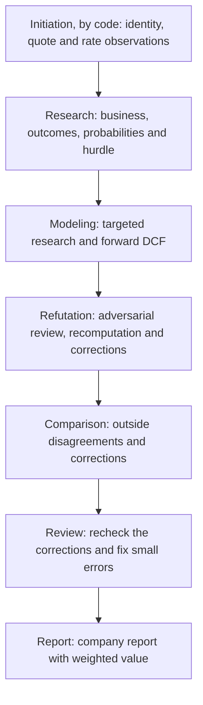

# Agent Targets Design

## Problem Statement

Manual equity research requires repeated prompt handoffs and reconciliation of conclusions across revisions. The user needs one CLI run that performs the research and valuation and saves an understandable company report with a weighted fair value and its outcome probabilities.

## Proposed Solution

A local Python runner first fetches the security, quote and rates from published sources, then coordinates six sequential research-agent stages: Research, Modeling, Refutation, Comparison, Review and Report. Refutation and Comparison correct the model in place, and Review checks those corrections and fixes small errors. The fetched facts form the initiation record, the first of seven pipeline steps and the only one run by code. All agent stages continue one Codex conversation, so each keeps the sources and calculations of the earlier stages and the runner sends only the common policy, ticker and initiation record once, at the start. Each stage's final message is saved, and the final stage's response is the saved report.

The agents perform all business research, analysis and financial calculation using their own research and calculation tools, and keep each outcome's forecast statements in a workbook of its own ([workbooks](workflow.md#workbooks)). The runner has a source integration only for the initiation facts, which are not analysis; it has no DCF calculator or validator of analytical content, and its only arithmetic is evaluating the formulas the agents wrote in their workbooks. It builds each prompt, invokes the model, retries a call that returns nothing, packs the workbooks and saves what comes back. See the [run lifecycle](execution.md#run-lifecycle).

### Scope

One supported company per run, with an English report and nominal USD common-equity values. The valuation uses an owner-cash-flow bridge, a constant diluted share basis, and a common hurdle equal to the U.S. 10-year Treasury yield plus Damodaran's implied equity risk premium. Forecast horizons and outcome counts follow the company's economics.

Foreign currencies and complex ownership structures need tested instructions before support is claimed. Portfolio sizing, brokerage actions and publication are outside scope. Keep one local runner, versioned prompts and file-based state.

## Technical Details

The user starts a run with `research WMT` (optionally `--model <model-id>`, default `gpt-5.6-sol`, and `--effort <level>`, default `xhigh`). The runner fetches the initiation record, creates a run directory, runs the agent stages in order and prints the final status and directory. See the [stage contracts](workflow.md#stage-contracts).

#### 1. Initiation: establish the security, quote and rates

Code, not an agent, reads the SEC ticker list for the legal name, CIK and listing exchange, the latest completed regular-session close from market-data chart data, the nominal 10-year Treasury yield from Treasury's XML feed, and Damodaran's monthly implied ERP from his workbook. It checks that each rate is fresh and saves the values, dates and sources as the initiation record. See [source acquisition](valuation.md#source-acquisition).

#### 2. Research: investigate the business and its outcomes together

The agent reconciles the historical baseline, classifies competitive advantages into structural buckets or rejects them with a reason, explores candidate outcomes, collects the topics outside analysts, call transcripts, news and company announcements treat as decisive and settles each in primary sources, investigates each candidate with supporting and contrary evidence, and sets the final outcomes and probabilities, together with the common hurdle. The quote, outside price targets and estimates never shape them. See [competitive advantage classification](valuation.md#competitive-advantage-classification), [outcome weighting](valuation.md#outcome-weighting) and the [discount rate](valuation.md#discount-rate).

#### 3. Modeling: research the forecast inputs and build the DCF

The agent researches the numerical inputs for each outcome and builds its forward statements, cash-flow schedule, terminal value and per-share value in that outcome's workbook, keeping research's outcomes and probabilities. See the [valuation method](valuation.md#agent-valuation-method) and the [statement conventions](valuation.md#statement-conventions).

#### 4. Refutation: challenge the completed work and correct it

The agent reviews its own earlier work as claims to test: it verifies claims against sources, challenges the distribution and economics, and recomputes each outcome's value. It then applies the calculation errors it reproduced and the material findings the evidence supports, and may change outcomes and probabilities only on evidence. Findings it does not apply stay as sensitivities, and they never stop the run. See [adversarial refutation](valuation.md#adversarial-refutation).

#### 5. Comparison: investigate outside disagreements and correct for them

The agent aligns outside research with the corrected model and the run's bases and adopts, rejects or leaves each discrepancy unresolved, without averaging outside targets into the DCF. It also tests every major outcome, catalyst or risk that outside analysts identify against the outcomes and partition, starting from the topics research recorded and flagging any that are missing or under-argued. It applies an adopted discrepancy to the model only when primary evidence supports it.

#### 6. Review: recheck the corrections

The agent recomputes every outcome the two previous stages changed or added, checks the probability total, the weighted value and each change log, and fixes small errors itself. A larger problem is left as it is and reported as a sensitivity. See the [stage contracts](workflow.md#stage-contracts).

#### 7. Report: produce the company report

The agent reconciles all earlier work, calculates the weighted fair value from the review's final outcome table and writes the ten-section report. See the [primary report](workflow.md#primary-report).

## Failure Handling

Two failures stop a run with exit code 3: an initiation source that cannot be read or is too old (before any model call), and a stage that returns no response within its attempts. Everything the agents find wrong, missing or uncertain is disclosed in their documents and carried into the report; it never stops a run. See [retries and limits](execution.md#retries-and-limits).

A saved report is not proof of correct valuation. Human review remains necessary for important source claims and economic judgments.

## Validation

Test the runner offline with a fake backend, the initiation parsers and freshness checks with saved source responses, the workbook packer with sample tab files, and the adapter with a short-lived real child process. `scripts/check-report.ps1` checks a finished report's section order, math delimiters and process wording, and `scripts/check-model.ps1` reports a finished run's workbook problems, failed check rows and per-outcome values. Judge research quality by having a reviewer read one real company report: its claims must follow from primary evidence, the weighted value must recompute from its outcome table, and the quote and outside targets must not have set the outcomes or weights. Discrepancies become prompt changes.

## Not Implemented

- Historical backtesting, dynamic financing, additional currencies, multi-company runs, Monte Carlo, other model providers, DOCX/PDF export, web interfaces, distributed workers and scheduled monitoring.

## Open Questions

- Which research model gives acceptable reports at acceptable time and cost?
- What timeout and attempt limits does the first company pilot justify?
- Do the saved records and evaluated workbooks in the report prompt keep the report's annual schedules complete and faithful?
- Does refutation in the author's own conversation find as many material problems as a separate conversation did in the ADBE pilot, and does correcting the model in the same stage make it less adversarial?
- Do refutation and comparison finish their longer stages within the call timeout when they rebuild an outcome?
- How often does the review stage find an error the earlier corrections introduced?

## References

- [Workflow: commands, stage handoffs and report content](workflow.md)
- [Valuation: sources, cash-flow methods, discount rate and outcome weighting](valuation.md)
- [Execution: model calls, run storage and retries](execution.md)
