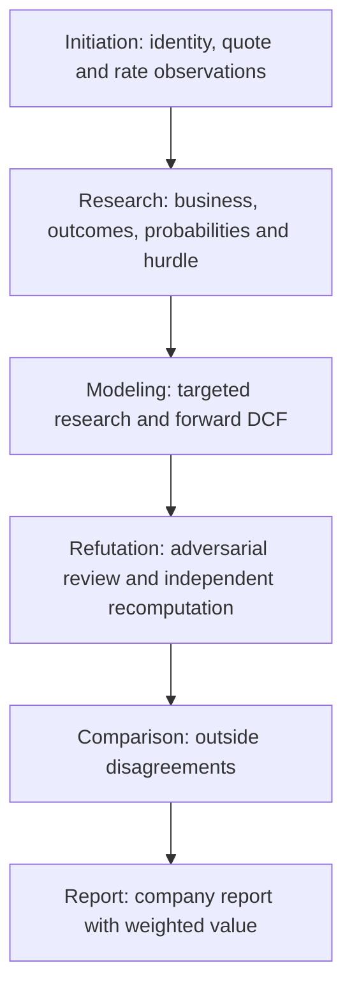

# Agent Targets Design

## Problem Statement

Manual equity research requires repeated prompt handoffs and reconciliation of conclusions across revisions. The user needs one CLI run that performs the research and valuation and saves an understandable company report with a weighted fair value and its outcome probabilities.

## Proposed Solution

A local Python runner coordinates six sequential research-agent stages: Initiation, Research, Modeling, Refutation, Comparison and Report. All six continue one Codex conversation, so each keeps the sources and calculations of the earlier stages and the runner sends only the common policy and ticker once, at the start. Each stage's final message is saved, and the final stage's response is the saved report.

The agents perform all source discovery, verification, analysis and financial calculation using their own research and calculation tools. The runner has no source integration, DCF calculator or validator of analytical content. It builds each prompt, invokes the model, retries a call that returns nothing, and saves what comes back. See the [run lifecycle](execution.md#run-lifecycle).

### Scope

One supported company per run, with an English report and nominal USD common-equity values. The valuation uses an owner-cash-flow bridge, a constant diluted share basis, and a common hurdle equal to the U.S. 10-year Treasury yield plus Damodaran's implied equity risk premium. Forecast horizons and outcome counts follow the company's economics.

Foreign currencies and complex ownership structures need tested instructions before support is claimed. Portfolio sizing, brokerage actions and publication are outside scope. Keep one local runner, versioned prompts and file-based state.

## Technical Details

The user starts a run with `research WMT` (optionally `--model <model-id>`, default `gpt-5.6-sol`, and `--effort <level>`, default `xhigh`). The runner creates a run directory, runs the stages in order and prints the final status and directory. See the [stage contracts](workflow.md#stage-contracts).

#### 1. Initiation: establish the company and sources

The agent resolves the security, finds the latest completed regular-session quote, and reads the nominal 10-year Treasury yield and the monthly Damodaran implied ERP from their official pages, with dates and citations. See [source acquisition](valuation.md#source-acquisition).

#### 2. Research: investigate the business and its outcomes together

The agent reconciles the historical baseline, assesses competitive advantages, explores candidate outcomes, investigates each with supporting and contrary evidence, and sets the final outcomes and probabilities, together with the common hurdle. The quote never shapes them. See [outcome weighting](valuation.md#outcome-weighting) and the [discount rate](valuation.md#discount-rate).

#### 3. Modeling: research the forecast inputs and build the DCF

The agent researches the numerical inputs for each outcome and builds its forward cash-flow schedule, terminal value and per-share value, keeping research's outcomes and probabilities. See the [valuation method](valuation.md#agent-valuation-method).

#### 4. Refutation: challenge the completed work

The agent reviews its own earlier work as claims to test: it verifies claims against sources, challenges the distribution and economics, and recomputes each outcome's value. Its findings stay in the conversation for the later stages; they do not stop the run. See [adversarial refutation](valuation.md#adversarial-refutation).

#### 5. Comparison: investigate outside disagreements

The agent aligns outside research with the run's bases and adopts, rejects or leaves each discrepancy unresolved, without averaging outside targets into the DCF.

#### 6. Report: produce the company report

The agent reconciles all earlier work, calculates the weighted fair value and writes the ten-section report. See the [primary report](workflow.md#primary-report).

## Failure Handling

The only failure the runner recognizes is a stage that returns no response within its attempts; the run then ends with exit code 3. Everything the agents find wrong, missing or uncertain is disclosed in their documents and carried into the report; it never stops a run. See [retries and limits](execution.md#retries-and-limits).

A saved report is not proof of correct valuation. Human review remains necessary for important source claims and economic judgments.

## Validation

Test the runner offline with a fake backend and the adapter with a short-lived real child process. `scripts/check-report.ps1` checks a finished report's section order, math delimiters and process wording. Judge research quality by having a reviewer read one real company report: its claims must follow from primary evidence, the weighted value must recompute from its outcome table, and the quote and outside targets must not have set the outcomes or weights. Discrepancies become prompt changes.

## Not Implemented

- Historical backtesting, dynamic financing, additional currencies, multi-company runs, Monte Carlo, other model providers, workbook/DOCX/PDF export, web interfaces, distributed workers and scheduled monitoring.

## Open Questions

- Which research model gives acceptable reports at acceptable time and cost?
- What timeout and attempt limits does the first company pilot justify?
- Do the saved records in the report prompt keep the report's annual schedules complete and faithful?
- Does refutation in the author's own conversation find as many material problems as a separate conversation did in the ADBE pilot?

## References

- [Workflow: commands, stage handoffs and report content](workflow.md)
- [Valuation: sources, cash-flow methods, discount rate and outcome weighting](valuation.md)
- [Execution: model calls, run storage and retries](execution.md)
